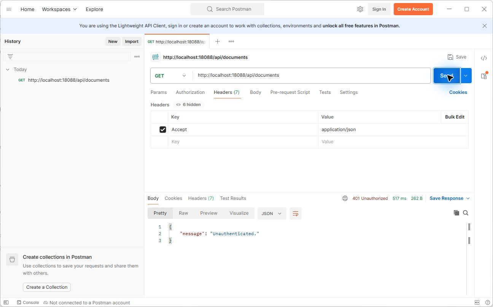
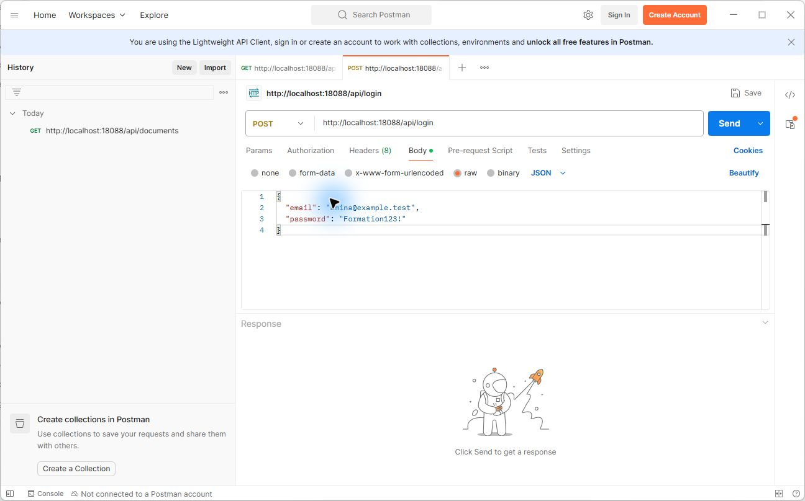
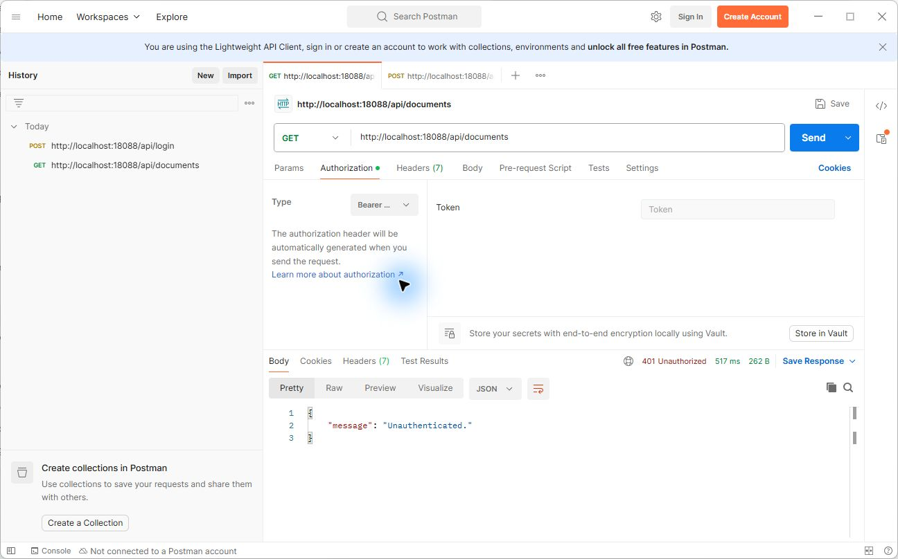
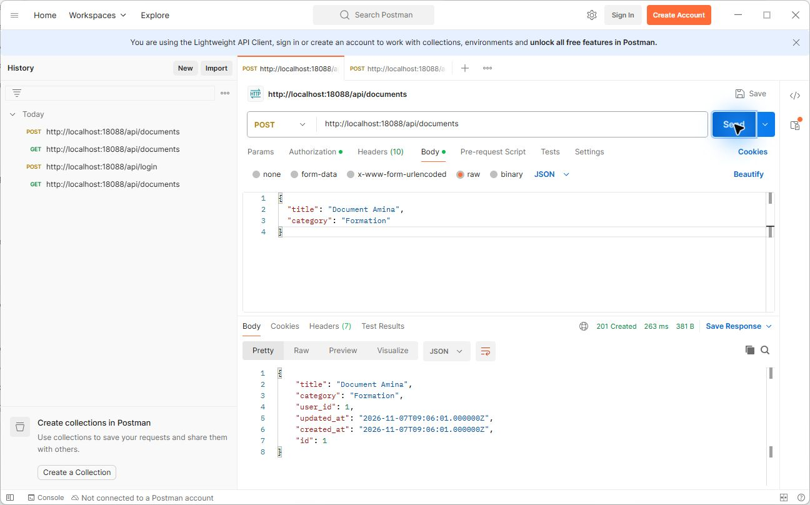
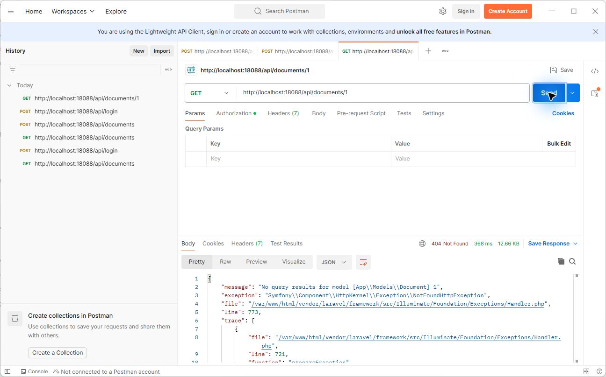
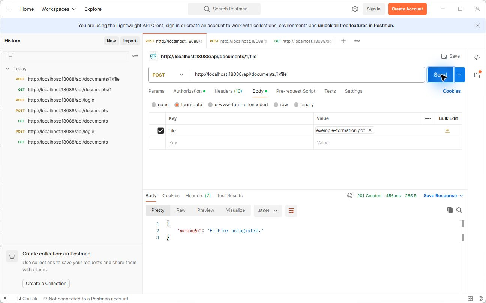

# TD unique : sécuriser les documents et leurs fichiers

## Objectifs

Vous allez faire évoluer l'API du jour 2 en trois étapes. À chaque étape, vérifiez le résultat avant de continuer.

1. Identifier les utilisateurs avec des tokens Sanctum et protéger l'API.
2. Associer les documents à leur propriétaire et limiter les accès.
3. Valider un fichier PDF, le stocker de façon privée et contrôler son téléchargement.

Les fichiers envoyés dans cet exercice sont fictifs. La validation proposée est une première barrière pédagogique : une extension, un type MIME et une signature corrects ne garantissent pas qu'un fichier est inoffensif. En production, d'autres contrôles et une analyse adaptée sont nécessaires.

## Avant de commencer

- Utilisez votre travail terminé ou la branche `jour3-form-requests`. La branche `jour3-securite-documents` contient la correction complète.
- Dans VS Code, ouvrez le dossier Laravel contenant `artisan` et `compose.yaml`. Ouvrez **Terminal > Nouveau terminal**, puis choisissez **PowerShell**. Les commandes de préparation de ce guide y sont exécutées. Installez aussi Postman : son mode gratuit sans connexion suffit pour les essais.
- Docker Desktop est démarré, le projet a été configuré et les migrations du jour 2 ont été réalisées. Ne recréez pas `.env` et ne régénérez pas la clé si le projet fonctionne déjà.
- Les commandes qui suivent créent deux comptes fictifs et modifient la base **locale de formation**. Les migrations sont à lancer pendant le cours, au moment indiqué par le formateur. Elles appliquent toutes les migrations en attente.
- Pour éviter toute perte de travail lors d'un changement de branche, contrôlez `git status` et sauvegardez vos modifications. Si Git refuse un changement, demandez de l'aide au formateur. Ne forcez pas le changement.

```powershell
git branch --show-current
docker compose up -d
docker compose ps
```

Les services `app` et `db` doivent être démarrés. Si vous devez rejoindre la branche de départ après avoir sauvegardé votre travail, utilisez `git switch jour3-form-requests`. Si la branche est introuvable, `git fetch origin` peut actualiser les références avant de réessayer.

> Les essais de l'API dans ce TD se font avec Postman. L'interface HTML du jour 2 ne transmet pas encore de token : une fois les routes protégées, elle ne pourra plus utiliser l'API sans adaptation. La liaison de l'interface n'est pas demandée dans ce TD.

---

## Étape 1 — Authentifier et protéger les routes

### Comprendre

L'authentification répond à la question « qui fait la demande ? ». Un client envoie un email et un mot de passe à `POST /api/login`. Si les identifiants sont valides, l'API émet un token Sanctum. Le client le transmet ensuite dans l'en-tête `Authorization: Bearer ...`.

Une session utilise généralement un cookie pour identifier une session côté serveur. Un token API peut être présenté par un client dans l'en-tête de ses requêtes. Un JWT est un format de token signé contenant des informations. Ici, nous utilisons les **tokens personnels Sanctum**, pas un JWT. Sanctum propose aussi une authentification par session pour les applications web ; ce TD se concentre sur les appels API.

Le token de l'exercice expire après huit heures et peut être révoqué avec `POST /api/logout`. Un token est un secret : ne l'ajoutez pas au dépôt et ne le partagez pas. Les mots de passe des comptes ci-dessous servent exclusivement à la formation locale.

### Installer Sanctum

À la racine du projet Laravel, dans PowerShell :

```powershell
docker compose exec app composer require laravel/sanctum:^4.3 --no-interaction --no-progress
docker compose exec app php artisan vendor:publish --provider='Laravel\Sanctum\SanctumServiceProvider' --tag=sanctum-migrations --no-interaction
```

Composer met à jour `composer.json` et `composer.lock`. La correction a été testée avec Sanctum 4.3.3. La publication crée une migration `*_create_personal_access_tokens_table.php` ; sa date dans le nom varie. Si une migration Sanctum existe déjà, demandez l'aide du formateur avant de publier une seconde copie.

### Ajouter la connexion

Créez le contrôleur et le seeder avec Artisan :

```powershell
docker compose exec app php artisan make:controller AuthController --no-interaction
docker compose exec app php artisan make:seeder FormationUsersSeeder --no-interaction
```

Si un fichier existe déjà, vérifiez votre branche avant de continuer. Dans VS Code, remplacez le contenu de chaque fichier indiqué par son bloc complet, puis enregistrez.

### Modèle utilisateur — `app/Models/User.php`

Le trait `HasApiTokens` permet à un utilisateur de créer des tokens Sanctum.

```php
<?php

namespace App\Models;

// use Illuminate\Contracts\Auth\MustVerifyEmail;
use Database\Factories\UserFactory;
use Illuminate\Database\Eloquent\Attributes\Fillable;
use Illuminate\Database\Eloquent\Attributes\Hidden;
use Illuminate\Database\Eloquent\Factories\HasFactory;
use Illuminate\Foundation\Auth\User as Authenticatable;
use Illuminate\Notifications\Notifiable;
use Laravel\Sanctum\HasApiTokens;

#[Fillable(['name', 'email', 'password'])]
#[Hidden(['password', 'remember_token'])]
class User extends Authenticatable
{
    /** @use HasFactory<UserFactory> */
    use HasApiTokens, HasFactory, Notifiable;

    /**
     * Get the attributes that should be cast.
     *
     * @return array<string, string>
     */
    protected function casts(): array
    {
        return [
            'email_verified_at' => 'datetime',
            'password' => 'hashed',
        ];
    }
}
```

### Contrôleur — `app/Http/Controllers/AuthController.php`

La réponse est volontairement identique pour un email absent et un mot de passe incorrect. La route de connexion sera limitée à dix tentatives par minute.

```php
<?php

namespace App\Http\Controllers;

use App\Models\User;
use Illuminate\Http\JsonResponse;
use Illuminate\Http\Request;
use Illuminate\Support\Facades\Hash;
use Laravel\Sanctum\PersonalAccessToken;

class AuthController extends Controller
{
    public function login(Request $request): JsonResponse
    {
        $data = $request->validate([
            'email' => ['required', 'email'],
            'password' => ['required', 'string'],
        ]);

        $user = User::where('email', $data['email'])->first();

        if (! $user || ! Hash::check($data['password'], $user->password)) {
            return response()->json(['message' => 'Identifiants invalides.'], 401);
        }

        $token = $user->createToken('formation', ['*'], now()->addHours(8));

        return response()->json(['token' => $token->plainTextToken]);
    }

    public function logout(Request $request): JsonResponse
    {
        $token = $request->user()->currentAccessToken();

        if ($token instanceof PersonalAccessToken) {
            $token->delete();
        }

        return response()->json(['message' => 'Token révoqué.']);
    }
}
```

### Comptes de démonstration — `database/seeders/FormationUsersSeeder.php`

Un seeder est une classe qui insère des données. Ouvrez **`database/seeders/FormationUsersSeeder.php`** dans VS Code, remplacez tout son contenu par le code suivant, puis enregistrez :

```php
<?php

namespace Database\Seeders;

use App\Models\User;
use Illuminate\Database\Seeder;
use RuntimeException;

class FormationUsersSeeder extends Seeder
{
    public function run(): void
    {
        if (! app()->environment('local')) {
            throw new RuntimeException('Ce seeder est réservé à la formation locale.');
        }

        User::firstOrCreate(
            ['email' => 'amina@example.test'],
            ['name' => 'Amina', 'password' => 'Formation123!'],
        );

        User::firstOrCreate(
            ['email' => 'karim@example.test'],
            ['name' => 'Karim', 'password' => 'Formation123!'],
        );
    }
}
```

`firstOrCreate` recherche chaque email et crée le compte seulement s'il est absent. Laravel hache les mots de passe grâce au modèle `User`. Le contrôle de l'environnement réserve ce seeder à la formation locale.

### Routes — `routes/api.php`

Le groupe `auth:sanctum` exige un utilisateur authentifié pour les routes des documents.

```php
<?php

use App\Http\Controllers\AuthController;
use App\Http\Controllers\DocumentController;
use App\Http\Controllers\DocumentExempleController;
use Illuminate\Support\Facades\Route;

Route::get('/exemples/document', [DocumentExempleController::class, 'show']);

Route::post('/login', [AuthController::class, 'login'])->middleware('throttle:10,1');

Route::middleware('auth:sanctum')->group(function (): void {
    Route::post('/logout', [AuthController::class, 'logout']);
    Route::get('/documents', [DocumentController::class, 'index']);
    Route::get('/documents/{document}', [DocumentController::class, 'show']);
    Route::post('/documents', [DocumentController::class, 'store']);
    Route::put('/documents/{document}', [DocumentController::class, 'update']);
    Route::delete('/documents/{document}', [DocumentController::class, 'destroy']);
});
```

### Appliquer et vérifier l'étape 1

Vérifiez que la configuration du projet est locale avant de créer les comptes. Demandez de l'aide au formateur si vous n'êtes pas sûr de la base utilisée.

```powershell
docker compose exec app php artisan migrate --no-interaction
```

La commande applique toutes les migrations en attente.

### Créer les deux utilisateurs avec le seeder

Après la migration, dans le terminal PowerShell du projet Laravel, lancez :

```powershell
docker compose exec app php artisan db:seed --class=FormationUsersSeeder --no-interaction
```

**À vérifier :** la commande affiche `FormationUsersSeeder ... DONE`. Les comptes fictifs `amina@example.test` et `karim@example.test` sont créés avec le mot de passe `Formation123!`. Ces identifiants sont réservés à la formation locale.

Si un compte existe déjà avec l'un de ces emails, le seeder le conserve sans changer son mot de passe. Si celui-ci est différent, demandez au formateur quels identifiants utiliser pour les commandes de connexion.

Dans pgAdmin, actualisez **Tables**, puis ouvrez la table **users** avec **View/Edit Data > All Rows** pour retrouver les comptes de démonstration. La table **personal_access_tokens** sera remplie après la connexion. Les mots de passe et tokens sont enregistrés sous forme de hachages : ne cherchez pas leurs valeurs en clair. L'accès à pgAdmin est décrit à l'étape 8 du [guide de démarrage](TD-Demarrage-Docker.md).

### Tester l'API avec Postman

Ouvrez Postman. Il n'est pas nécessaire de créer un compte ni d'enregistrer une collection. Le bouton **Send** envoie la requête ; le code de réponse s'affiche en bas à droite.

> Les captures ont été prises sur une installation de test utilisant le port **18088**. Pour votre projet, utilisez toujours le port **8088** et les adresses écrites dans le guide. Les identifiants de documents peuvent aussi être différents.

#### 1. Vérifier l'accès sans connexion

1. Cliquez sur **+** pour ouvrir une requête. Choisissez **GET** à gauche de l'adresse.
2. Saisissez `http://localhost:8088/api/documents`.
3. Cliquez sur **Headers** et ajoutez la clé `Accept` avec la valeur `application/json`.
4. Dans **Authorization**, vérifiez que le type est **No Auth**, puis cliquez sur **Send**.

**À vérifier :** la réponse est **401 Unauthorized** : l'API demande une authentification.



#### 2. Connecter Amina

1. Ouvrez un deuxième onglet avec **+**. Choisissez **POST** et saisissez `http://localhost:8088/api/login`.
2. Dans **Headers**, ajoutez `Accept` : `application/json`.
3. Cliquez sur **Body**, sélectionnez **raw**, puis **JSON** dans la liste à droite.
4. Copiez ce contenu dans la zone de texte et cliquez sur **Send** :

```json
{
  "email": "amina@example.test",
  "password": "Formation123!"
}
```



**À vérifier :** la réponse est **200 OK** et contient un champ `token`. Sélectionnez et copiez toute sa valeur, y compris le chiffre et le caractère `|`, sans les guillemets. Le token est personnel : ne le partagez pas et ne le mettez pas dans Git.

#### 3. Utiliser puis révoquer le token

1. Revenez au premier onglet, celui de `GET /api/documents`.
2. Cliquez sur **Authorization** et choisissez **Bearer Token** dans **Type**.
3. Collez le token d'Amina dans **Token**, sans ajouter le mot `Bearer`, puis cliquez sur **Send**.



Sur cette capture, le champ est encore vide et le 401 affiché correspond à la requête précédente.

**À vérifier :** la liste répond **200 OK**. À ce stade, les documents ne sont pas encore filtrés par propriétaire.

Pour tester la déconnexion, ouvrez un autre onglet : sélectionnez **POST**, saisissez `http://localhost:8088/api/logout`, ajoutez le header `Accept: application/json`, puis choisissez **Authorization > Bearer Token** et collez le même token. Cliquez sur **Send**. La réponse confirme la déconnexion. Revenez à la liste et cliquez à nouveau sur **Send** : elle répond maintenant **401**.

Pour continuer, reconnectez Amina dans l'onglet de connexion et copiez le **nouveau** token dans **Authorization** de l'onglet des documents. Gardez cet onglet pour la suite. Après dix tentatives de connexion en une minute, une réponse **429** peut apparaître : patientez avant de réessayer.


---

## Étape 2 — Associer les documents à leur propriétaire

### Comprendre

Être connecté répond à « qui êtes-vous ? ». L'autorisation répond à « pouvez-vous accéder à ce document ? ». Chaque nouveau document reçoit l'identifiant de l'utilisateur connecté. Les recherches s'effectuent dans ses documents : un document appartenant à une autre personne reçoit ici une réponse **404**.

La colonne `user_id` accepte `null` pour conserver les documents déjà présents avant cette étape. Ces anciens documents sans propriétaire ne seront affichés dans la liste d'aucun utilisateur. Leur attribution doit être décidée séparément avec le formateur ; ce TD ne les attribue pas automatiquement.

### Créer la migration

```powershell
docker compose exec app php artisan make:migration add_user_id_to_documents_table --table=documents --no-interaction
```

Dans `database/migrations`, ouvrez le nouveau fichier dont le nom se termine par `add_user_id_to_documents_table.php`. Sa date diffère de celle de la correction. Remplacez son contenu par :

```php
<?php

use Illuminate\Database\Migrations\Migration;
use Illuminate\Database\Schema\Blueprint;
use Illuminate\Support\Facades\Schema;

return new class extends Migration
{
    /**
     * Run the migrations.
     */
    public function up(): void
    {
        Schema::table('documents', function (Blueprint $table) {
            $table->foreignId('user_id')->nullable()->constrained()->nullOnDelete();
        });
    }

    /**
     * Reverse the migrations.
     */
    public function down(): void
    {
        Schema::table('documents', function (Blueprint $table) {
            $table->dropConstrainedForeignId('user_id');
        });
    }
};
```

Remplacez ensuite le contenu des fichiers suivants.

### Modèle utilisateur — `app/Models/User.php`

La relation `documents()` permet de retrouver les documents appartenant à un utilisateur.

```php
<?php

namespace App\Models;

// use Illuminate\Contracts\Auth\MustVerifyEmail;
use Database\Factories\UserFactory;
use Illuminate\Database\Eloquent\Attributes\Fillable;
use Illuminate\Database\Eloquent\Attributes\Hidden;
use Illuminate\Database\Eloquent\Factories\HasFactory;
use Illuminate\Database\Eloquent\Relations\HasMany;
use Illuminate\Foundation\Auth\User as Authenticatable;
use Illuminate\Notifications\Notifiable;
use Laravel\Sanctum\HasApiTokens;

#[Fillable(['name', 'email', 'password'])]
#[Hidden(['password', 'remember_token'])]
class User extends Authenticatable
{
    /** @use HasFactory<UserFactory> */
    use HasApiTokens, HasFactory, Notifiable;

    /** @return HasMany<Document, $this> */
    public function documents(): HasMany
    {
        return $this->hasMany(Document::class);
    }

    /**
     * Get the attributes that should be cast.
     *
     * @return array<string, string>
     */
    protected function casts(): array
    {
        return [
            'email_verified_at' => 'datetime',
            'password' => 'hashed',
        ];
    }
}
```

### Contrôleur — `app/Http/Controllers/DocumentController.php`

Chaque lecture et modification part de la relation de l’utilisateur connecté. Le propriétaire est fixé côté serveur à la création.

```php
<?php

namespace App\Http\Controllers;

use App\Http\Requests\DocumentRequest;
use Illuminate\Http\JsonResponse;
use Illuminate\Http\Request;
use Illuminate\Http\Response;

class DocumentController extends Controller
{
    public function index(Request $request): JsonResponse
    {
        return response()->json($request->user()->documents()->get());
    }

    public function show(Request $request, string $document): JsonResponse
    {
        return response()->json($request->user()->documents()->findOrFail($document));
    }

    public function store(DocumentRequest $request): JsonResponse
    {
        $data = $request->validated();

        $document = $request->user()->documents()->create($data);

        return response()->json($document, 201);
    }

    public function update(DocumentRequest $request, string $document): JsonResponse
    {
        $data = $request->validated();

        $document = $request->user()->documents()->findOrFail($document);
        $document->update($data);

        return response()->json($document);
    }

    public function destroy(Request $request, string $document): Response
    {
        $request->user()->documents()->findOrFail($document)->delete();

        return response()->noContent();
    }
}
```

### Routes — `routes/api.php`

Les identifiants de documents sont limités aux chiffres.

```php
<?php

use App\Http\Controllers\AuthController;
use App\Http\Controllers\DocumentController;
use App\Http\Controllers\DocumentExempleController;
use Illuminate\Support\Facades\Route;

Route::get('/exemples/document', [DocumentExempleController::class, 'show']);

Route::post('/login', [AuthController::class, 'login'])->middleware('throttle:10,1');

Route::middleware('auth:sanctum')->group(function (): void {
    Route::post('/logout', [AuthController::class, 'logout']);
    Route::get('/documents', [DocumentController::class, 'index']);
    Route::get('/documents/{document}', [DocumentController::class, 'show'])->whereNumber('document');
    Route::post('/documents', [DocumentController::class, 'store']);
    Route::put('/documents/{document}', [DocumentController::class, 'update'])->whereNumber('document');
    Route::delete('/documents/{document}', [DocumentController::class, 'destroy'])->whereNumber('document');
});
```

### Appliquer et vérifier l'étape 2

```powershell
docker compose exec app php artisan migrate --no-interaction
```

### Créer un document pour Amina

1. Dans l'onglet des documents, vérifiez que **Authorization > Bearer Token** contient le token valide d'Amina.
2. Choisissez **POST** et saisissez `http://localhost:8088/api/documents`.
3. Dans **Body**, choisissez **raw**, puis **JSON**. Copiez ce contenu et cliquez sur **Send** :

```json
{
  "title": "Document Amina",
  "category": "Formation"
}
```

**À vérifier :** la réponse **201 Created** affiche le document, notamment son `id` et son `user_id`. Notez l'`id` : vous l'utiliserez dans les adresses suivantes. Par exemple, si l'`id` vaut 1, l'adresse sera `/api/documents/1`.



Dans pgAdmin, ouvrez ou actualisez **documents > View/Edit Data > All Rows**. Repérez la nouvelle ligne et comparez son `user_id` à l'identifiant d'Amina dans **users**.

Pour vérifier qu'Amina peut le lire, gardez son token, choisissez **GET**, saisissez `http://localhost:8088/api/documents/1` en remplaçant `1` par votre `id`, puis cliquez sur **Send** : la réponse est **200 OK**.

### Essayer avec Karim

1. Revenez à l'onglet de connexion `POST /api/login`. Remplacez le contenu de **Body > raw > JSON** par :

```json
{
  "email": "karim@example.test",
  "password": "Formation123!"
}
```

2. Cliquez sur **Send**, puis copiez la valeur du token de Karim sans les guillemets.
3. Ouvrez un nouvel onglet **+**, choisissez **GET** et saisissez `http://localhost:8088/api/documents/1` en remplaçant `1` par l'`id` du document d'Amina.
4. Dans **Headers**, ajoutez `Accept: application/json`. Dans **Authorization**, choisissez **Bearer Token**, collez le token de Karim et cliquez sur **Send**.

**À vérifier :** Karim reçoit **404 Not Found** pour le document d'Amina. Dans ce même onglet, remplacez l'adresse par `http://localhost:8088/api/documents` et cliquez sur **Send** : sa liste ne contient pas le document d'Amina.



Gardez les deux onglets de documents : l'un utilise le token d'Amina, l'autre celui de Karim. Vérifiez le token dans **Authorization** si vous changez d'onglet.


---

## Étape 3 — Envoyer et télécharger un PDF privé

### Comprendre

Un document contient déjà des métadonnées en base. Nous lui ajoutons ici **un seul fichier PDF**, après sa création. Le serveur vérifie sa taille (1 Mo maximum), l'extension `.pdf`, le type détecté et les cinq premiers octets `%PDF-`. Le nom stocké est généré par Laravel dans le disque local privé `storage/app/private`.

Le chemin de stockage n'est pas renvoyé dans le JSON. Le téléchargement passe par une route protégée qui vérifie le propriétaire. Les fichiers déjà associés ne sont pas remplacés : une seconde tentative renvoie **409**. Pour l'exercice, la suppression d'un document supprime aussi son fichier.

### Créer les fichiers

```powershell
docker compose exec app php artisan make:migration add_file_path_to_documents_table --table=documents --no-interaction
docker compose exec app php artisan make:controller DocumentFileController --no-interaction
docker compose exec app php artisan make:request DocumentFileRequest --no-interaction
```

Dans `database/migrations`, ouvrez le nouveau fichier se terminant par `add_file_path_to_documents_table.php` et remplacez son contenu :

```php
<?php

use Illuminate\Database\Migrations\Migration;
use Illuminate\Database\Schema\Blueprint;
use Illuminate\Support\Facades\Schema;

return new class extends Migration
{
    /**
     * Run the migrations.
     */
    public function up(): void
    {
        Schema::table('documents', function (Blueprint $table) {
            $table->string('file_path')->nullable();
        });
    }

    /**
     * Reverse the migrations.
     */
    public function down(): void
    {
        Schema::table('documents', function (Blueprint $table) {
            $table->dropColumn('file_path');
        });
    }
};
```

Remplacez ensuite tout le contenu des fichiers suivants.

### Modèle — `app/Models/Document.php`

L’attribut `Hidden` évite d’exposer le chemin privé dans les réponses JSON.

```php
<?php

namespace App\Models;

use Illuminate\Database\Eloquent\Attributes\Fillable;
use Illuminate\Database\Eloquent\Attributes\Hidden;
use Illuminate\Database\Eloquent\Model;

#[Fillable(['title', 'category'])]
#[Hidden(['file_path'])]
class Document extends Model {}
```

### Validation — `app/Http/Requests/DocumentFileRequest.php`

Les règles vérifient le fichier puis la fonction lit les premiers octets.

```php
<?php

namespace App\Http\Requests;

use Closure;
use Illuminate\Foundation\Http\FormRequest;
use Illuminate\Http\UploadedFile;

class DocumentFileRequest extends FormRequest
{
    public function authorize(): bool
    {
        return true;
    }

    /** @return array<string, array<int, mixed>> */
    public function rules(): array
    {
        return [
            'file' => [
                'bail',
                'required',
                'file',
                'max:1024',
                'extensions:pdf',
                'mimes:pdf',
                function (string $attribute, mixed $value, Closure $fail): void {
                    if (! $value instanceof UploadedFile || ! $value->isValid()) {
                        $fail('Le fichier est invalide.');

                        return;
                    }

                    $handle = fopen($value->getRealPath(), 'rb');
                    if ($handle === false) {
                        $fail('Impossible de lire le fichier.');

                        return;
                    }

                    $signature = fread($handle, 5);
                    fclose($handle);

                    if ($signature !== '%PDF-') {
                        $fail('La signature du fichier PDF est invalide.');
                    }
                },
            ],
        ];
    }
}
```

### Contrôleur des fichiers — `app/Http/Controllers/DocumentFileController.php`

Le contrôle du propriétaire précède le stockage et le téléchargement.

```php
<?php

namespace App\Http\Controllers;

use App\Http\Requests\DocumentFileRequest;
use Illuminate\Http\JsonResponse;
use Illuminate\Http\Request;
use Illuminate\Support\Facades\DB;
use Illuminate\Support\Facades\Storage;
use Symfony\Component\HttpFoundation\StreamedResponse;
use Throwable;

class DocumentFileController extends Controller
{
    public function store(DocumentFileRequest $request, string $document): JsonResponse
    {
        $path = null;

        try {
            return DB::transaction(function () use ($request, $document, &$path): JsonResponse {
                $record = $request->user()->documents()->lockForUpdate()->findOrFail($document);

                if ($record->file_path !== null) {
                    return response()->json(['message' => 'Ce document possède déjà un fichier.'], 409);
                }

                $path = $request->file('file')->store('documents', 'local');
                if ($path === false) {
                    abort(500, 'Impossible de stocker le fichier.');
                }

                $record->file_path = $path;
                $record->save();

                return response()->json(['message' => 'Fichier enregistré.'], 201);
            });
        } catch (Throwable $exception) {
            if (is_string($path)) {
                Storage::disk('local')->delete($path);
            }

            throw $exception;
        }
    }

    public function download(Request $request, string $document): StreamedResponse
    {
        $record = $request->user()->documents()->findOrFail($document);
        $disk = Storage::disk('local');

        if ($record->file_path === null || ! $disk->exists($record->file_path)) {
            abort(404);
        }

        return $disk->download($record->file_path, 'document-'.$record->id.'.pdf', [
            'Content-Type' => 'application/pdf',
            'X-Content-Type-Options' => 'nosniff',
        ]);
    }
}
```

### Contrôleur des documents — `app/Http/Controllers/DocumentController.php`

La suppression prend également en charge le fichier associé.

```php
<?php

namespace App\Http\Controllers;

use App\Http\Requests\DocumentRequest;
use Illuminate\Http\JsonResponse;
use Illuminate\Http\Request;
use Illuminate\Http\Response;
use Illuminate\Support\Facades\DB;
use Illuminate\Support\Facades\Storage;

class DocumentController extends Controller
{
    public function index(Request $request): JsonResponse
    {
        return response()->json($request->user()->documents()->get());
    }

    public function show(Request $request, string $document): JsonResponse
    {
        return response()->json($request->user()->documents()->findOrFail($document));
    }

    public function store(DocumentRequest $request): JsonResponse
    {
        $data = $request->validated();

        $document = $request->user()->documents()->create($data);

        return response()->json($document, 201);
    }

    public function update(DocumentRequest $request, string $document): JsonResponse
    {
        $data = $request->validated();

        $document = $request->user()->documents()->findOrFail($document);
        $document->update($data);

        return response()->json($document);
    }

    public function destroy(Request $request, string $document): Response
    {
        DB::transaction(function () use ($request, $document): void {
            $record = $request->user()->documents()->lockForUpdate()->findOrFail($document);

            if ($record->file_path !== null && ! Storage::disk('local')->delete($record->file_path)) {
                abort(500, 'Impossible de supprimer le fichier.');
            }

            $record->delete();
        });

        return response()->noContent();
    }
}
```

### Routes — `routes/api.php`

Les routes d’envoi et de téléchargement restent dans le groupe protégé.

```php
<?php

use App\Http\Controllers\AuthController;
use App\Http\Controllers\DocumentController;
use App\Http\Controllers\DocumentExempleController;
use App\Http\Controllers\DocumentFileController;
use Illuminate\Support\Facades\Route;

Route::get('/exemples/document', [DocumentExempleController::class, 'show']);

Route::post('/login', [AuthController::class, 'login'])->middleware('throttle:10,1');

Route::middleware('auth:sanctum')->group(function (): void {
    Route::post('/logout', [AuthController::class, 'logout']);
    Route::get('/documents', [DocumentController::class, 'index']);
    Route::get('/documents/{document}', [DocumentController::class, 'show'])->whereNumber('document');
    Route::post('/documents', [DocumentController::class, 'store']);
    Route::put('/documents/{document}', [DocumentController::class, 'update'])->whereNumber('document');
    Route::delete('/documents/{document}', [DocumentController::class, 'destroy'])->whereNumber('document');
    Route::post('/documents/{document}/file', [DocumentFileController::class, 'store'])->whereNumber('document');
    Route::get('/documents/{document}/file', [DocumentFileController::class, 'download'])->whereNumber('document');
});
```

### Appliquer et vérifier l'étape 3

```powershell
docker compose exec app php artisan migrate --no-interaction
```

Préparez un **vrai PDF fictif de moins de 1 Mo** sur votre ordinateur, par exemple en exportant une page de texte en PDF. N'utilisez pas de fichier confidentiel.

### Envoyer le PDF d'Amina

1. Revenez à l'onglet de documents d'Amina et vérifiez son token dans **Authorization**.
2. Choisissez **POST** et saisissez `http://localhost:8088/api/documents/1/file`, en remplaçant `1` par l'`id` de son document.
3. Cliquez sur **Body**, puis **form-data**. Dans la colonne **Key**, saisissez `file`.
4. Survolez la ligne `file`, cliquez sur la petite flèche à droite de la clé et choisissez **File**. Dans **Value**, cliquez sur **Select Files** et choisissez votre PDF.
5. Cliquez sur **Send**. Postman construit automatiquement le contenu multipart : ne définissez pas manuellement son `Content-Type`.

**À vérifier :** la réponse est **201 Created** et confirme l'enregistrement. Si vous cliquez une seconde fois sur **Send**, la réponse est **409**, car ce document possède déjà un fichier.



Dans pgAdmin, actualisez les lignes de **documents** et observez `file_path` sur le document d'Amina : c'est son chemin dans le stockage privé de Laravel.

### Vérifier l'accès au fichier

1. Dans l'onglet de Karim, conservez son token, choisissez **GET** et saisissez `http://localhost:8088/api/documents/1/file`, avec l'`id` du document d'Amina. Cliquez sur **Send** : la réponse est **404**.
2. Dans l'onglet d'Amina, vérifiez son token et choisissez **GET** pour la même adresse. À côté de **Send**, cliquez sur la flèche, puis sur **Send and Download**.
3. Choisissez où enregistrer le fichier, puis ouvrez-le et comparez-le au PDF d'origine. La réponse est **200 OK**.

### Vérifier le refus d'un faux PDF

1. Créez un nouveau document pour Amina comme à l'étape 2, par exemple avec le titre `Document pour fichier invalide`, et notez son `id`.
2. Avec un éditeur de texte, créez un fichier contenant `Ce fichier est du texte.` et enregistrez-le sous le nom `faux.pdf` ; vérifiez que son nom ne se termine pas par `.txt`.
3. Envoyez ce fichier avec **POST**, **Body > form-data**, clé `file` de type **File**, à l'adresse `http://localhost:8088/api/documents/1/file` en remplaçant `1` par l'`id` du nouveau document. Gardez le token d'Amina.

**À vérifier :** la réponse est **422**. Changer le nom d'un fichier ne transforme pas son contenu en PDF. Ne mettez pas les fichiers d'essai dans Git.


## Tests automatiques

Les tests de l'ancien CRUD doivent être adaptés à l'authentification et à la propriété. Créez également deux fichiers de test :

```powershell
docker compose exec app php artisan make:test --phpunit SecurityApiTest --no-interaction
docker compose exec app php artisan make:test --phpunit DocumentFileTest --no-interaction
```

Si l'un de ces fichiers existe déjà, vérifiez votre branche avant de le remplacer. Dans VS Code, remplacez les fichiers indiqués par les blocs suivants.

### CRUD — `tests/Feature/DocumentApiTest.php`


```php
<?php

namespace Tests\Feature;

use App\Models\User;
use Illuminate\Foundation\Testing\RefreshDatabase;
use Tests\TestCase;

class DocumentApiTest extends TestCase
{
    use RefreshDatabase;

    private User $user;

    protected function setUp(): void
    {
        parent::setUp();

        $this->user = User::factory()->create();
        $this->actingAs($this->user, 'sanctum');
    }

    public function test_documents_can_be_listed_and_retrieved(): void
    {
        $document = $this->user->documents()->create(['title' => 'Contrat', 'category' => 'Administratif']);

        $this->getJson('/api/documents')
            ->assertOk()
            ->assertJsonCount(1)
            ->assertJsonFragment(['id' => $document->id, 'title' => 'Contrat']);

        $this->getJson('/api/documents/'.$document->id)
            ->assertOk()
            ->assertJsonPath('category', 'Administratif');
    }

    public function test_document_can_be_created_updated_and_deleted(): void
    {
        $response = $this->postJson('/api/documents', [
            'title' => 'Contrat',
            'category' => 'Administratif',
        ])->assertCreated()->assertJsonPath('title', 'Contrat');

        $id = $response->json('id');
        $this->assertDatabaseHas('documents', ['id' => $id, 'title' => 'Contrat']);

        $this->putJson('/api/documents/'.$id, [
            'title' => 'Contrat mis à jour',
            'category' => 'Formation',
        ])->assertOk()->assertJsonPath('title', 'Contrat mis à jour');

        $this->assertDatabaseHas('documents', ['id' => $id, 'category' => 'Formation']);
        $this->deleteJson('/api/documents/'.$id)->assertNoContent();
        $this->assertDatabaseMissing('documents', ['id' => $id]);
        $this->getJson('/api/documents/'.$id)->assertNotFound();
    }

    public function test_invalid_data_is_rejected_on_create_and_update(): void
    {
        $document = $this->user->documents()->create(['title' => 'Original', 'category' => 'Formation']);

        $this->postJson('/api/documents', [])->assertUnprocessable()
            ->assertJsonValidationErrors(['title', 'category']);

        $this->postJson('/api/documents', [
            'title' => str_repeat('a', 101),
            'category' => str_repeat('b', 51),
        ])->assertUnprocessable()->assertJsonValidationErrors(['title', 'category']);

        $this->putJson('/api/documents/'.$document->id, [
            'title' => 'Modifié',
        ])->assertUnprocessable()->assertJsonValidationErrors(['category']);

        $this->assertDatabaseHas('documents', [
            'id' => $document->id,
            'title' => 'Original',
            'category' => 'Formation',
        ]);
    }

    public function test_unknown_document_returns_not_found(): void
    {
        $this->getJson('/api/documents/999999')->assertNotFound();
        $this->putJson('/api/documents/999999', [
            'title' => 'Absent',
            'category' => 'Formation',
        ])->assertNotFound();
        $this->deleteJson('/api/documents/999999')->assertNotFound();
    }
}
```

### Authentification et propriété — `tests/Feature/SecurityApiTest.php`


```php
<?php

namespace Tests\Feature;

use App\Models\Document;
use App\Models\User;
use Illuminate\Foundation\Testing\RefreshDatabase;
use Tests\TestCase;

class SecurityApiTest extends TestCase
{
    use RefreshDatabase;

    public function test_authentication_and_token_revocation(): void
    {
        User::factory()->create(['email' => 'amina@example.test', 'password' => 'Formation123!']);

        $this->getJson('/api/documents')->assertUnauthorized();
        $this->postJson('/api/login', [
            'email' => 'amina@example.test',
            'password' => 'incorrect',
        ])->assertUnauthorized();

        $token = $this->postJson('/api/login', [
            'email' => 'amina@example.test',
            'password' => 'Formation123!',
        ])->assertOk()->json('token');

        $this->withToken($token)->getJson('/api/documents')->assertOk();
        $this->withToken($token)->postJson('/api/logout')->assertOk();
        $this->assertDatabaseCount('personal_access_tokens', 0);
        $this->app['auth']->forgetGuards();
        $this->withToken($token)->getJson('/api/documents')->assertUnauthorized();
    }

    public function test_users_cannot_access_other_users_or_unowned_documents(): void
    {
        $amina = User::factory()->create();
        $karim = User::factory()->create();
        $document = $amina->documents()->create(['title' => 'Privé', 'category' => 'Formation']);
        $legacy = Document::create(['title' => 'Ancien', 'category' => 'Formation']);

        $this->actingAs($karim, 'sanctum');
        $this->getJson('/api/documents')->assertOk()->assertJsonCount(0);
        $this->getJson('/api/documents/'.$document->id)->assertNotFound();
        $this->putJson('/api/documents/'.$document->id, ['title' => 'Autre', 'category' => 'Formation'])->assertNotFound();
        $this->deleteJson('/api/documents/'.$document->id)->assertNotFound();
        $this->getJson('/api/documents/'.$legacy->id)->assertNotFound();
        $this->assertDatabaseHas('documents', ['id' => $document->id, 'title' => 'Privé']);
        $this->assertDatabaseHas('documents', ['id' => $legacy->id, 'user_id' => null]);
    }
}
```

### Fichiers — `tests/Feature/DocumentFileTest.php`


```php
<?php

namespace Tests\Feature;

use App\Models\User;
use Illuminate\Foundation\Testing\RefreshDatabase;
use Illuminate\Http\UploadedFile;
use Illuminate\Support\Facades\Storage;
use Tests\TestCase;

class DocumentFileTest extends TestCase
{
    use RefreshDatabase;

    public function test_private_pdf_is_available_only_to_its_owner(): void
    {
        Storage::fake('local');
        $owner = User::factory()->create();
        $other = User::factory()->create();
        $document = $owner->documents()->create(['title' => 'Contrat', 'category' => 'Formation']);
        $contents = "%PDF-1.4\nContenu de test\n%%EOF";

        $this->getJson('/api/documents/'.$document->id.'/file')->assertUnauthorized();
        $this->actingAs($owner, 'sanctum')->postJson('/api/documents/'.$document->id.'/file', [
            'file' => UploadedFile::fake()->createWithContent('contrat.pdf', $contents),
        ])->assertCreated();

        $path = $document->fresh()->file_path;
        Storage::disk('local')->assertExists($path);
        $this->getJson('/api/documents/'.$document->id)->assertJsonMissingPath('file_path');
        $this->get('/api/documents/'.$document->id.'/file')->assertOk()->assertDownload('document-'.$document->id.'.pdf');
        $this->postJson('/api/documents/'.$document->id.'/file', [
            'file' => UploadedFile::fake()->createWithContent('autre.pdf', $contents),
        ])->assertStatus(409);

        $this->actingAs($other, 'sanctum');
        $this->getJson('/api/documents/'.$document->id.'/file')->assertNotFound();
        $this->postJson('/api/documents/'.$document->id.'/file', [
            'file' => UploadedFile::fake()->createWithContent('autre.pdf', $contents),
        ])->assertNotFound();

        $this->actingAs($owner, 'sanctum')->deleteJson('/api/documents/'.$document->id)->assertNoContent();
        Storage::disk('local')->assertMissing($path);
    }

    public function test_invalid_uploads_are_rejected_without_storing_a_file(): void
    {
        Storage::fake('local');
        $user = User::factory()->create();
        $document = $user->documents()->create(['title' => 'Contrat', 'category' => 'Formation']);
        $this->actingAs($user, 'sanctum');

        $this->postJson('/api/documents/'.$document->id.'/file', [
            'file' => UploadedFile::fake()->createWithContent('faux.pdf', 'Ce fichier est du texte.'),
        ])->assertUnprocessable()->assertJsonValidationErrors('file');
        $this->postJson('/api/documents/'.$document->id.'/file', [
            'file' => UploadedFile::fake()->createWithContent('document.txt', '%PDF-1.4'),
        ])->assertUnprocessable()->assertJsonValidationErrors('file');
        $this->postJson('/api/documents/'.$document->id.'/file', [
            'file' => UploadedFile::fake()->create('grand.pdf', 1025, 'application/pdf'),
        ])->assertUnprocessable()->assertJsonValidationErrors('file');

        $this->assertNull($document->fresh()->file_path);
        $this->assertSame([], Storage::disk('local')->allFiles('documents'));
    }
}
```

Lancez les tests dans le conteneur :

```powershell
docker compose exec app php artisan test --compact tests/Feature/DocumentApiTest.php tests/Feature/SecurityApiTest.php tests/Feature/DocumentFileTest.php
```

**À vérifier :** les huit tests réussissent. Ils utilisent SQLite en mémoire et un stockage de test. Ils ne modifient pas les documents de la base PostgreSQL de formation.

## Vérifications et comparaison

La branche `jour3-securite-documents` contient la correction complète. Avant de changer de branche, sauvegardez votre travail. Dans le même dépôt, `git fetch origin` récupère les références puis `git diff origin/jour3-securite-documents` permet de comparer les fichiers suivis. Les nouveaux fichiers non encore suivis ne sont pas affichés par ce `git diff` : ouvrez-les aussi avec `git show origin/jour3-securite-documents:chemin/du/fichier`.

Les étapes HTTP de ce TD permettent aussi de vérifier votre propre travail avant d'ouvrir la correction.

## En cas de difficulté

| Situation | Vérification |
| --- | --- |
| `401` sur les documents | Reconnectez l'utilisateur et actualisez l'en-tête `Bearer`. Vérifiez si le token a expiré ou a été révoqué. |
| `429` à la connexion | La limite de tentatives est atteinte. Attendez une minute. |
| Connexion refusée pour un compte fictif | Vérifiez le résultat du seeder et l'email. Si le compte existait déjà, son mot de passe n'a pas été changé : demandez au formateur quels identifiants utiliser. |
| `404` sur le document | Vérifiez son identifiant et son propriétaire. Les anciens documents sans propriétaire ne sont visibles par aucun compte. |
| `409` à l'envoi | Un fichier est déjà associé. Créez un autre document pour refaire l'essai. |
| `422` à l'envoi | Vérifiez le contenu PDF, sa signature, son extension et la limite de 1 Mo. |
| `Class ... Sanctum` introuvable | Vérifiez que Composer a réussi dans le conteneur et que les dépendances sont synchronisées. |
| Table absente | Vérifiez les migrations avec `docker compose exec app php artisan migrate:status`. |

## Questions de compréhension

1. Quelle différence existe entre authentification et autorisation ?
2. Pourquoi un token révoqué ne donne-t-il plus accès aux routes ?
3. Pourquoi le serveur détermine-t-il le propriétaire au lieu de le recevoir du client ?
4. Pourquoi une extension `.pdf` ne suffit-elle pas pour valider un fichier ?
5. Pourquoi le téléchargement passe-t-il par une route protégée ?
